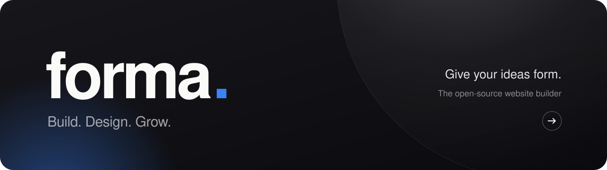
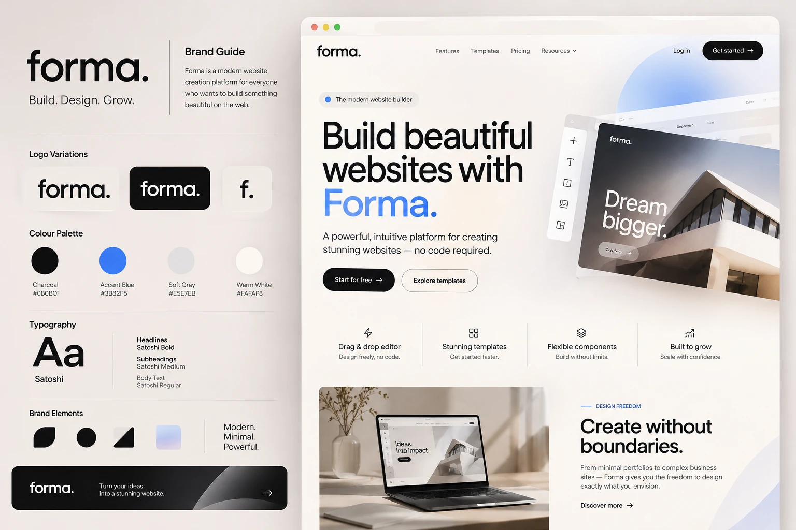
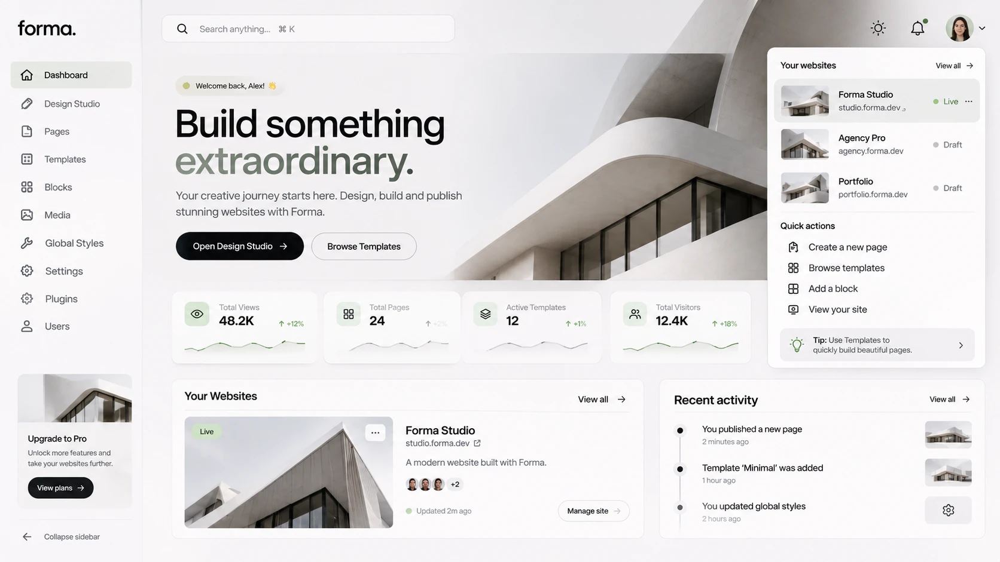

<div align="center">



<br />
<br />

**Forma is an open-source website builder for everyone who wants to build something beautiful on the web.**
<br />
Design freely, build with reusable blocks, and publish polished, responsive sites — no code required.

<br />

[](https://vuejs.org)
[](https://vite.dev)
[](https://tailwindcss.com)
[](https://www.typescriptlang.org)
[](https://dotnet.microsoft.com)
[](https://learn.microsoft.com/ef/core/providers/sqlite/)
[](#contributing)

[What's inside](#whats-inside) · [Getting started](#getting-started) · [Design system](#design-system) · [Project structure](#project-structure) · [Roadmap](#roadmap) · [Contributing](#contributing)

</div>

<br />



<br />

## Why Forma

Building a website should feel like shaping an idea, not fighting a tool. Forma gives designers, freelancers, agencies and ambitious businesses a calm, considered workspace to go **from idea to online**.

<table>
  <tr>
    <td width="25%" valign="top">
      <h3>⚡ Drag & drop</h3>
      Design freely with visual controls and thoughtful defaults. No code.
    </td>
    <td width="25%" valign="top">
      <h3>▦ Templates</h3>
      Start from beautiful, fully responsive starting points and make them yours.
    </td>
    <td width="25%" valign="top">
      <h3>◈ Components</h3>
      Combine reusable blocks, sections and components. Build without limits.
    </td>
    <td width="25%" valign="top">
      <h3>↗ Built to grow</h3>
      Open source and self-hostable. Your server, your data, your rules.
    </td>
  </tr>
</table>

## A look inside

The Forma dashboard is where creative work starts: your websites, quick actions, recent activity and the Design Studio, one click away.



<p align="center"><sub>Dashboard concept: the app in <code>src/app</code> is in active development.</sub></p>

## What's inside

Forma is a monorepo with three runnable parts that share one design system.

| Part | Path | Stack | Dev URL |
| --- | --- | --- | --- |
| **Landing page** | [`src/landing`](src/landing) | Vue 3 · Vite · Tailwind CSS v4 | http://localhost:5173 |
| **App** (CMS) | [`src/app`](src/app) | Vue 3 · Vue Router · TanStack Vue Query | http://localhost:5174 |
| **API** | [`src/api`](src/api) | ASP.NET Core 10 minimal APIs · EF Core · SQLite | http://localhost:5134 |

### Landing page

The public marketing site: hero, features, templates, workflow and the open-source pitch, built entirely from `@forma/design-system` components.

- `/`: landing page
- `/#/design-system`: the living brand guide and component showcase

More in [`src/landing/README.md`](src/landing/README.md).

### App

The Forma CMS, where you manage your websites, their pages and their media.

| Route            | What it does                                                    |
| ---------------- | --------------------------------------------------------------- |
| `/`              | Dashboard: websites, stats, recent activity                     |
| `/pages`         | Pages of the active website: filter, create, publish, archive   |
| `/media`         | Media library of the active website: stats, upload with progress (button, drag & drop or paste), grid or list, preview, delete |
| `/websites/:id?` | Switch the active website and edit its details                  |
| everything else  | Sections that are designed but not built yet show "coming soon" |

Websites, pages and media load from the API through a typed client generated from its OpenAPI document (`@hey-api/openapi-ts` + TanStack Vue Query). Recent activity is still seed data. Media uploads and deletes go to the API; other edits only update the query cache until their write endpoints exist. In development Vite proxies `/api/*` to the API. Set `FORMA_API_URL` to proxy somewhere else, or `VITE_API_URL` to call a different base URL directly.

More in [`src/app/README.md`](src/app/README.md).

### API

A .NET 10 backend in three projects ([`Forma.Api.slnx`](src/api/Forma.Api.slnx)):

| Project                | Responsibility                                                       |
| ---------------------- | -------------------------------------------------------------------- |
| `Forma.Api`            | Minimal API endpoints, DTOs and Mapperly mappers, OpenAPI + Scalar   |
| `Forma.Application`    | Domain entities and core services                                    |
| `Forma.Infrastructure` | EF Core `DbContext`, SQLite, migrations, seeding, repositories, media file storage and image processing |

| Endpoint                    | Returns                                                         |
| --------------------------- | --------------------------------------------------------------- |
| `GET /websites`             | All websites                                                    |
| `GET /pages?websiteId={id}` | The pages of one website                                        |
| `GET /media?websiteId={id}` | The media library of one website                                |
| `GET /media/{id}`           | One media item                                                  |
| `GET /media/{id}/image`     | The original image's bytes                                      |
| `GET /media/{id}/thumbnail` | The WebP thumbnail's bytes                                      |
| `POST /media`               | Uploads an image (multipart: `websiteId`, `file`), `201` or `400` |
| `DELETE /media/{id}`        | Deletes a media item and its files, `204`                       |

#### Media

Uploads are images only: JPEG, PNG, GIF or WebP, at most 10 MB. A FluentValidation validator checks the size, file name and extension before the upload reaches the core service, which then checks the format from the file's bytes, so anything else (SVG included) is rejected with `400`. The API keeps the original unchanged and renders a WebP thumbnail of at most 400 px on its longest side, with EXIF rotation applied, using [NetVips](https://github.com/kleisauke/net-vips) (libvips).

Files are stored as plain files in the folder `Assets:Path` (default `assets`, `/app/assets` in Docker), under `{websiteId}/originals/{id}.{ext}` and `{websiteId}/thumbnails/{id}.webp`. Storage sits behind `IAssetStorage`, so an S3-compatible store can be added later without touching the rest of the API. Files are served through the API's `/media/{id}/image` and `/media/{id}/thumbnail` routes, which each media item's `imageUrl` and `thumbnailUrl` point to.

In development the API applies migrations and seeds sample data on startup into `forma.db`, which is git-ignored. It serves interactive docs at **http://localhost:5134/scalar**. Each `dotnet build` writes the OpenAPI document to `src/api/Forma.Api/OpenApi/forma-api.json`, and the app's client is generated from that file.

## Getting started

You'll need **Node.js 20+** with npm, plus the **.NET 10 SDK** for the API.

```bash
git clone https://github.com/ericvdberge/Forma.git
cd Forma
npm install
```

Then start the part you're working on:

```bash
npm run dev:landing                                            # landing page → :5173
dotnet run --project src/api/Forma.Api --launch-profile http   # API → :5134
npm run dev:app -- --port 5174                                 # app → :5174 (needs the API)
```

| Script                  | What it does                                                 |
| ----------------------- | ------------------------------------------------------------ |
| `npm run dev:landing`   | Start the landing page with hot reload                       |
| `npm run dev:app`       | Start the CMS app with hot reload                            |
| `npm run build:landing` | Type-check and build the landing page                        |
| `npm run build:app`     | Type-check and build the CMS app                             |
| `npm run type-check`    | Type-check every workspace                                   |
| `npm run generate:api`  | Build the API and regenerate the app's typed client from it  |

After you change an API endpoint or DTO, run `npm run generate:api` and commit the updated OpenAPI document and generated client. Don't edit `src/app/src/api/generated` by hand.

### Docker

The [`Dockerfile`](Dockerfile) builds Forma into one image. [supervisord](http://supervisord.org) runs and restarts two processes:

| Process   | What it does                                                                 |
| --------- | ---------------------------------------------------------------------------- |
| `nginx`   | Serves the CMS app on port 8080 and proxies `/api` to the API                 |
| `api`     | The Forma API, with its SQLite database in `/app/data` (a volume)             |

```bash
docker build -t forma .
docker run -p 8080:8080 -v forma-assets:/app/assets -v forma-data:/app/data forma
```

Or run `docker compose up --build forma` ([`docker-compose.yml`](docker-compose.yml)). Run `docker exec <container> supervisorctl -c /etc/supervisor/forma.conf status` to see the processes. Uploaded media are plain files in `/app/assets`, a volume. The API applies database migrations on start. Because websites can't be created yet, an empty database gets the sample websites and pages; set `FORMA_SAMPLE_DATA=false` to start without them.

## Project structure

```text
Forma/
├── src/
│   ├── design-system/   @forma/design-system: brand tokens + Vue components
│   ├── landing/         Marketing site (Vue 3 + Vite)
│   ├── app/             The Forma CMS: dashboard, websites, pages & media (Vue 3 + Vue Router)
│   └── api/             .NET 10 backend (Forma.Api.slnx)
│       ├── Forma.Api/             endpoints, DTOs, OpenAPI document
│       ├── Forma.Application/     entities + core services
│       └── Forma.Infrastructure/  EF Core, SQLite, repositories, media storage
├── docker/              nginx, supervisord and entrypoint for the image
├── Dockerfile           app + API in one image
└── package.json         npm workspaces root
```

## Design system

Everything Forma ships is built on [`@forma/design-system`](src/design-system), a shared package of brand tokens (as a Tailwind CSS v4 `@theme`) and accessible, `F`-prefixed Vue components.

```ts
import '@forma/design-system/styles.css'
import { FButton, FCard, FLogo } from '@forma/design-system'
```

```vue
<FButton href="/start" arrow>Start for free</FButton>
```

### Colour

<table>
  <tr>
    <td align="center" width="25%"><br /><b>Charcoal</b><br /><code>#0B0B0F</code></td>
    <td align="center" width="25%"><br /><b>Accent Blue</b><br /><code>#3B82F6</code></td>
    <td align="center" width="25%"><br /><b>Soft Gray</b><br /><code>#E5E7EB</code></td>
    <td align="center" width="25%"><br /><b>Warm White</b><br /><code>#FAFAF8</code></td>
  </tr>
  <tr>
    <td align="center"><br /><sub>Ink <code>#171717</code></sub></td>
    <td align="center"><br /><sub>Canvas <code>#F5F4F0</code></sub></td>
    <td align="center"><br /><sub>Stone <code>#D8D2C8</code></sub></td>
    <td align="center"><br /><sub>Sage <code>#A8B5A0</code></sub></td>
  </tr>
</table>

Warm neutrals create a calm canvas. Charcoal brings clarity; a restrained blue accent signals interaction and momentum.

### Typography

One typeface, three voices: **[Satoshi](https://www.fontshare.com/fonts/satoshi)**.

| Role        | Weight  | Usage                                   |
| ----------- | ------- | --------------------------------------- |
| Headlines   | Bold    | Tight tracking, generous size           |
| Subheadings | Medium  | Section titles, cards, navigation       |
| Body        | Regular | Long-form copy, descriptions, UI labels |

The wordmark is always lowercase with tight tracking and a distinctive full stop: **forma.**

### Principles

|                | |
| -------------- | --- |
| **Whitespace** | Give content room to breathe. Use generous spacing and clear hierarchy. |
| **Structure**  | Use grids, alignment and consistent spacing to create visual order. |
| **Restraint**  | Prefer fine borders and subtle depth over heavy shadows and decoration. |
| **Clarity**    | Make controls, actions and product benefits immediately understandable. |

### Voice

Forma speaks with clarity and quiet confidence. No hype, no jargon, no exaggerated promises.

> **Give your ideas form.** · **Design. Build. Publish.** · **Beautiful websites. Less friction.**

## Roadmap

- [x] Brand guide & design tokens
- [x] Shared design system package
- [x] Landing page
- [x] Dashboard & website management
- [x] Pages list
- [x] API: read websites & pages
- [x] API: media library (image uploads with thumbnails)
- [x] Media library
- [ ] API: create, update & publish
- [ ] Design Studio: drag & drop editor
- [ ] Templates, blocks & global styles
- [ ] Publishing & custom domains
- [ ] Self-hosting guide

## Contributing

Contributions of every size are welcome: bug reports, ideas, docs and code.

1. Fork the repo and create a branch: `git checkout -b feat/my-idea`
2. Install and run the part you're changing (see [Getting started](#getting-started))
3. Make sure it builds: `npm run type-check` and the matching `npm run build:*`, plus `dotnet build src/api/Forma.Api.slnx` for API changes
4. Open a pull request against `main`

Found a bug or have a suggestion? [Open an issue](https://github.com/ericvdberge/Forma/issues).

<br />

<div align="center">
  <sub><b>forma.</b> &nbsp;·&nbsp; Modern. Minimal. Powerful.</sub>
</div>
