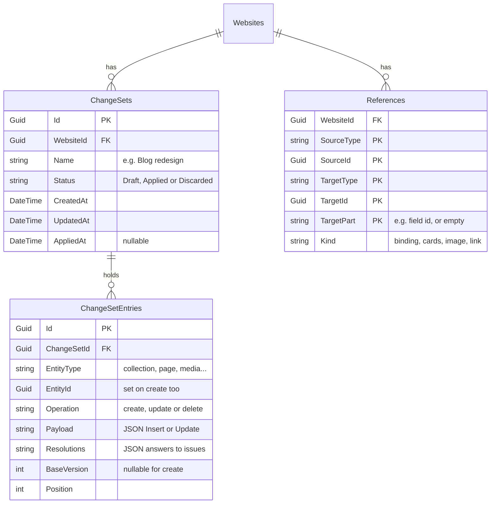

# Change sets

Status: **proposed**. To be built in its own PR. The first use is changing a collection's fields ([§ 8](#8-first-use-a-collections-fields)); the system itself knows nothing about collections or pages.

## 1. The problem

Some edits only make sense together. Applied one at a time, the site is broken in between:

- remove a collection field, add a new one, move the values across and point the detail page at it;
- delete an image that four pages show, after giving those pages another image;
- change a page's address and update every link to it;
- redesign several pages and publish them at the same moment, now or at a set time.

Each of these crosses entities, and none can be guarded by a database constraint, because the references live inside JSON (field ids, image sources, links).

## 2. The idea

A **change set** is a named draft of changes to any number of entities. While it is open, nothing is live. You can see the site *as it would be* with the changes, review what they will do, answer any questions they raise, and then **apply** them: every change runs in one database transaction, and either all of it happens or none of it does.

The system is generic. It deals in **entries** ("update this entity to this"), **references** ("this entity points at that one"), **issues** ("this would break that") and **handlers** (one per entity type, that know how to check and apply that type). Adding a new entity type to change sets means writing its handler; the engine, tables, API and UI stay as they are.

## 3. Concepts

| Concept | What it is |
|---|---|
| **Change set** | A named draft: *"Blog redesign"*. Status `Draft`, `Applied` or `Discarded`. Belongs to a website. |
| **Entry** | One change to one entity: `create`, `update` or `delete`, with a payload. The payload is the entity's existing `{Entity}Insert` or `{Entity}Update`, the same object its core service already takes, so a staged change is exactly the call Apply will make. |
| **Base version** | The entity's `Version` when the entry was made. Apply refuses if it moved since. |
| **Staged view** | Reads "as if the change set were applied": an entity with an entry comes from the entry, anything else from the database. The studio and the review read through it. |
| **Reference** | A row saying *source points at target*, optionally at a part of it: page → collection field `fld_cover`, page → media item, page → page (a link). Kept up to date by the handlers whenever a source is written. Replaces separate tables like `PageMediaUsages` and `PageBindingUsages`. |
| **Breakage** | What a change takes away from a target: a removed field, a deleted entity, a changed address, a narrower field type. |
| **Issue** | A finding from the review: `blocking` or `warning`, a message, and where. An issue can offer **choices** (*Move values to… / Remove values*). |
| **Resolution** | The answer to an issue's choice, stored on the entry. Handlers read it when they apply. |
| **Derived changes** | Changes a handler works out at Apply instead of storing as entries: rewriting the values of 300 items is one resolution, not 300 entries. The review shows their count. |

## 4. How it works

**Review**, run on every save and again inside Apply:

1. Each entry's handler checks the entry's target state against the staged view (the same validation the type uses today) and lists its **breakages**.
2. For each breakage, the engine looks up the **references** that point at it and asks the source's handler whether the source still holds, reading the source through the staged view, so a page fixed in the same change set passes.
3. Each handler describes its entry in plain words and counts its derived changes.
4. The result is one list: what changes, what it affects, what is blocking, and which questions are still open.

**Apply**, inside one transaction:

1. Check every entry's base version (`409` if one moved).
2. Run the review; stop with `400` if anything blocks.
3. Apply entries in order: creates, then updates, then deletes, so references never point at something missing midway. Each handler calls its own core service with the stored payload, then its derived changes.
4. Rebuild the references of every source that changed.
5. Mark the change set `Applied`, then commit. Any failure rolls back everything.

**Writes outside change sets** keep working as now. An entity that has an entry in an open change set answers `409` to direct writes, with the change set's name, so nothing is changed in two places at once. Later, direct writes can become a change set of one entry that is applied at once, so every write goes through the same checks.

## 5. How it looks

The UI is generic too. Every editor that supports change sets gets the same pieces:

- **"Save to change set"** beside **Save**, and a change-set switcher in the top bar (*Editing: Blog redesign ▾*). While one is active, editors show the staged view and save into it.
- A **Changes** panel: the change set's entries grouped by what they touch, each with a one-line description from its handler (*"Blog posts: removed Cover image, added Hero image"*).
- **Review**: three sections, the same for every type:

  | Section | Example |
  |---|---|
  | Changes | *Blog posts*: 2 field changes · *Blog post page*: redesigned · *Home*: redesigned |
  | Effects | 14 items get their *Cover image* moved to *Hero image* |
  | Needs attention | *Cover image* has values in 14 items: **Move to… / Remove** · *About* links to a page this deletes (blocking) |

- **Apply**, disabled while anything is blocking and saying why; **Discard**; later **Schedule**. After applying: *"Blog redesign applied: 3 changes, 14 items updated"*.
- A conflict reads: *"Blog posts changed since this change set was started. Review the changes again."*

## 6. Database

The generic part. Each entity that can be part of a change set gets a `Version` column (a concurrency token); nothing else about its table changes.



- `ChangeSetEntries (ChangeSetId, EntityType, EntityId)` is unique: one entry per entity per change set; editing it again replaces the payload.
- `ChangeSetEntries (EntityType, EntityId)` is unique among open change sets, so an entity is in at most one open change set. SQLite has no filtered unique index across tables, so the entry carries a copy of the change set's status for this index, or the engine checks it (to decide in the PR).
- `References` is indexed by target, for "what points at this".
- `EntityType` and `EntityId` are not foreign keys: the tables stay generic. Deleting an entity directly removes its entries and references in the same core-service call; inside a change set that can't happen, because the entity is locked.

Constraints that the database *can* enforce stay in the database. The two for pages are in [§ 8](#8-first-use-a-collections-fields).

## 7. Code

Layers stay as `CLAUDE.md` describes them. The engine is a set of supporting services; handlers call core services; core services and repositories stay CRUD only.

```csharp
/// One per entity type that can be part of a change set.
public interface IChangeHandler
{
    string EntityType { get; }

    /// The entity as it is now, or null; the engine overlays staged entries on this.
    Task<IVersioned?> LoadAsync(Guid entityId, CancellationToken ct);

    /// Checks the entry's target state and lists what it takes away from others.
    Task<EntryCheck> CheckAsync(ChangeEntry entry, IStagedView view, CancellationToken ct);

    /// A target this entity points at loses something: does this entity still hold?
    Task<IReadOnlyList<Issue>> CheckReferenceAsync(Guid sourceId, Breakage breakage, IStagedView view, CancellationToken ct);

    /// Plain-language lines and derived-change counts for the review.
    Task<EntryDescription> DescribeAsync(ChangeEntry entry, IStagedView view, CancellationToken ct);

    /// Calls the core service with the payload, then applies derived changes using the resolutions.
    Task ApplyAsync(ChangeEntry entry, IStagedView view, CancellationToken ct);

    /// The references this entity holds, rebuilt after every write.
    IReadOnlyList<Reference> GetReferences(object entity);
}
```

| Piece | Kind | Does |
|---|---|---|
| `ChangeSetCoreService`, `ChangeSetEntryCoreService`, `ReferenceCoreService` | core | CRUD, with `{Entity}Filter` |
| `IStagedView` | supporting | `GetAsync(type, id)`: the staged entry's state, else the handler's `LoadAsync` |
| `ChangeSetReviewService` | supporting | Runs § 4's review over all handlers |
| `ChangeSetApplyService` | supporting | Runs § 4's apply inside `ITransactionRunner` |
| `ITransactionRunner` | infrastructure | Wraps `db.Database.BeginTransactionAsync`; the request-scoped `DbContext` makes every repository's `SaveChangesAsync` join it |
| `ReferenceIndexService` | supporting | Replaces a source's references with `handler.GetReferences(entity)` |

Handlers are registered by entity type (`services.AddChangeHandler<CollectionChangeHandler>()`), and the engine finds them by `EntityType`. Issues use the same `{ code, severity, message, path }` shape as the publish checks, so the existing page checks become issues without being rewritten.

**API**, the same for every entity type:

| Method | Route | Purpose |
|---|---|---|
| `GET` / `POST` | `/change-sets?websiteId=` | Open change sets of a website / start one `{ websiteId, name }` |
| `GET` / `DELETE` | `/change-sets/{id}` | One change set with its entries / discard it |
| `PUT` | `/change-sets/{id}/entries/{entityType}/{entityId}` | Stage a change `{ operation, payload }`, `200` or `400` |
| `DELETE` | `/change-sets/{id}/entries/{entityType}/{entityId}` | Unstage it |
| `PUT` | `/change-sets/{id}/entries/{entityType}/{entityId}/resolutions` | Answer an issue's choice |
| `GET` | `/change-sets/{id}/review` | The review of § 4 |
| `POST` | `/change-sets/{id}/apply` | `200` with counts, `400` with blocking issues, `409` on a stale version |
| `GET` | `/change-sets/{id}/view/{entityType}/{entityId}` | An entity through the staged view (studio, editors) |

Every read is narrowed by the change set's website (IDOR); an entry's entity must belong to the same website, which its handler's `LoadAsync` checks with a filter.

## 8. First use: a collection's fields

What collections need on top of the engine. This is the only collection-specific part.

**Handlers**

- `CollectionChangeHandler`: payload `CollectionUpdate` (fields included). Breakages: removed fields, narrowed field types, new required fields. Its own items are **derived changes**, not references: resolutions say per removed field *move to `fld_…`* or *remove*, and per new required field the value for existing items. Apply rewrites every item's values and checks them with `CollectionItemValidationService`.
- `PageChangeHandler`: payload `PageContentUpdate` (a new document; applying it publishes it). References: bindings and `collectionCards` → collection fields, images → media, links → pages. `CheckReferenceAsync` runs the existing publish checks (`binding.field_missing`, `binding.type_mismatch`…) on the staged document.

**Database, collection side**

- `Version` on `Collections` and `PageContents`.
- `CK_Pages_Kind`: `(Kind = 'Static' AND CollectionId IS NULL) OR (Kind = 'CollectionTemplate' AND CollectionId IS NOT NULL)`.
- A detail page is on its collection's website: `Pages (WebsiteId, CollectionId)` → `Collections (WebsiteId, Id)`, with `(WebsiteId, Id)` as an alternate key on `Collections`.
- `PageMediaUsages` moves into `References`; the planned `PageBindingUsages` is never built.

**App**: the collection field editor saves fields only to a change set (name, slug and icon still save directly), shows *"Used by…"* from `References`, and the studio opens a detail page in the active change set, so its "Connect to field" menus show the staged fields.

**What `PUT /collections/{id}` changes**: it stops taking `fields`.

## 9. Other uses, later

Each is a new handler or a new breakage, with no change to the engine:

- **Deleting media** in use: stage the delete, the review lists the pages showing it, fix them in the same change set.
- **Changing a page's address**: breakage *address changed*; sources linking to it offer *Update links*.
- **Releases**: several redesigned pages published at once.
- **Scheduled apply**: `ApplyAt` on the change set, run by a background job through `ChangeSetApplyService`; the version check makes a late apply safe.
- **History and undo**: applied change sets stay; storing each entry's previous state at Apply makes an inverse change set possible.
- **Field type changes** with a conversion preview in the review.

## 10. Implementation PR

One PR, in this order:

1. `ITransactionRunner`; `ChangeSets`, `ChangeSetEntries`, `References` with core services and repositories; `Version` on `Collections` and `PageContents`.
2. Engine: `IChangeHandler`, `IStagedView`, review and apply services, endpoints. Tests with a fake handler, so the engine is tested without any real entity.
3. `PageChangeHandler`, `CollectionChangeHandler`; move `PageMediaUsages` into `References` (migration with backfill); the two `Pages` constraints.
4. App: change-set switcher, Changes panel, review screen; field editor and studio on change sets; `npm run generate:api`.
5. Tests: rollback on a failing step, `409` on a stale version, resolutions rewrite items, a broken `collectionCards` on another page blocks Apply, a page fixed in the same change set passes.
6. Update the data model diagram in `src/api/README.md`.
