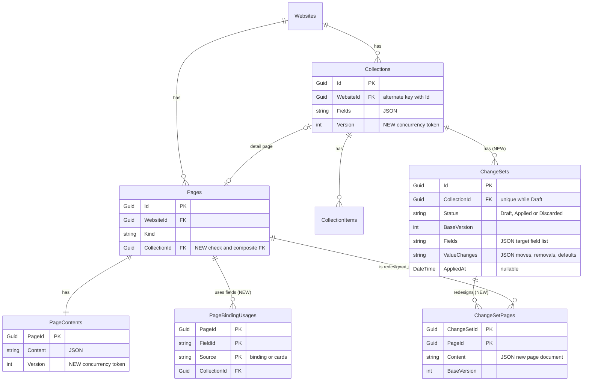

# Changing a collection's fields

Status: **proposed**. Builds on [collections.md](collections.md); to be built in its own PR.

## 1. The problem

A collection's fields are referred to by id (`fld_…`) from three places, all inside JSON columns:

- `CollectionItems.Values`: the item's values, keyed by field id;
- `PageContents.Content`: blocks' `bindings` (`{ prop: { scope, field } }`), mostly on the detail page;
- `collectionCards` blocks on any page: `collectionId`, `imageField`, `titleField`, `textField`.

Today `PUT /collections/{id}` saves a new field list and nothing else. Removing a field leaves those references dangling: item values are dropped the next time an item is saved, and pages only find out when they are next published (`binding.field_missing`). A database constraint can't help, because it can't see into JSON.

What a person actually wants is often several steps that only make sense together: *remove Cover image, add Hero image, move the values across, and point the detail page's image at the new field*. Done one at a time, the site is broken in between.

## 2. The idea: change sets

A **change set** is a draft of changes to one collection's fields, together with the page designs that have to change with them. Nothing in it is live. The person reviews what it will do, then **applies** it: every step runs in one database transaction, and either all of it happens or none of it does.

- Name, singular name, slug and icon still save straight away (`PUT /collections/{id}`): they can't break anything.
- **Fields are only changed through a change set.** One way to edit fields keeps the UI predictable. A change that breaks nothing is one click to apply; the review only has something to say when there is something to say.
- A collection has at most **one open change set**. Opening the field editor opens it, or picks up the one already there.

## 3. How it looks

**Field editor.** Edits are staged. A bar at the top shows *"3 unapplied changes"* with **Review and apply** and **Discard**. Each field shows where it is used (*"Used by the detail page and 14 items"*).

**Removing a field that has values or is used.** Instead of failing, the editor asks what to do with its values:

- **Move values to…** another field of a compatible type (it may be a field added in the same change set);
- **Remove values**;
- or cancel and keep the field.

**Adding a required field** when items already exist asks for a **value for existing items** (left empty, those items are listed in the review as blocking).

**Designing pages against the new fields.** The review lists the pages that use the collection. **Open in studio** opens a page in the context of the change set: the "Connect to field" menus and the preview item show the *new* fields, and saving stores the design in the change set instead of publishing it. Pages with bindings that the change set breaks are marked until they are fixed.

**Review.** One screen, in plain words, grouped by what it touches:

| Section | Example |
|---|---|
| Fields | Added *Hero image* · Removed *Cover image* · *Summary* is now required |
| Items | 14 items: *Cover image* moves to *Hero image* · 2 items have no *Summary* (blocking) |
| Pages | *Blog post page*: redesigned in this change set · *Home*: its cards show *Cover image*; pick another field (blocking) |

**Apply** is disabled while anything is blocking, and says why. After applying: *"Blog posts updated: 14 items, 2 pages"*. If someone changed the collection or one of the pages since the change set was opened, Apply refuses with *"Blog posts changed since you started. Review the changes again."* and the review is recalculated.

## 4. What a change set holds

It stores the **target state**, not a log of edits. Collections and page documents are already read and written whole, and a target state is easy to diff, review and re-check.

- `Fields`: the complete new field list (new fields get their ids when they are added to the change set, so pages and moves can refer to them).
- `ValueChanges`: per removed field, `{ from, to }` (move) or `{ from, to: null }` (remove); per new required field, `{ field, defaultValue }`.
- Pages: per changed page, the complete new document.
- The versions it was based on, for the conflict check.

## 5. Database

**Constraints that the database can enforce**, added in the same PR:

- `CK_Pages_Kind`: `(Kind = 'Static' AND CollectionId IS NULL) OR (Kind = 'CollectionTemplate' AND CollectionId IS NOT NULL)`.
- A detail page and its collection are on the same website: `Pages (WebsiteId, CollectionId)` → `Collections (WebsiteId, Id)`, with `(WebsiteId, Id)` as an alternate key on `Collections`.
- One open change set per collection: unique index on `ChangeSets (CollectionId)` where `Status = 'Draft'`.
- All foreign keys cascade, as now: deleting a collection deletes its change sets; deleting a page deletes its usages and its `ChangeSetPages` rows.

**`PageBindingUsages`** is derived: rebuilt for a page whenever its content is published (and inside Apply), like `PageMediaUsages`. It answers "what uses this field" for the field editor and the review without scanning every document. `collections.md` § 4 already plans it; `CollectionId` is added so it can be read by collection.

Field ids inside JSON stay checked by the API, not the database (no triggers that parse JSON: rules live in services).

## 6. API

All routes are under the collection, so every read is narrowed by it (IDOR, as in `CLAUDE.md`). `{id}` is the collection.

| Method | Route | Purpose |
|---|---|---|
| `GET` | `/collections/{id}/change-set` | The open change set, or `204` |
| `PUT` | `/collections/{id}/change-set` | Create or save it: `{ fields, valueChanges }`, `200` or `400` |
| `PUT` | `/collections/{id}/change-set/pages/{pageId}` | Save a page's new design into it: `{ document }` (level 1 checks only), `200` or `400` |
| `DELETE` | `/collections/{id}/change-set/pages/{pageId}` | Drop a page's new design from it |
| `GET` | `/collections/{id}/change-set/review` | The impact report of § 3, with blocking issues |
| `POST` | `/collections/{id}/change-set/apply` | Apply: `200` with the counts, `400` with the blocking issues, `409` when a base version changed |
| `DELETE` | `/collections/{id}/change-set` | Discard |

`PUT /collections/{id}` no longer takes `fields`. `PUT /pages/{id}/content` answers `409` for a page that is in an open change set, so a page is not changed in two places at once.

## 7. Services

The layers stay as `CLAUDE.md` describes them.

- **Core services** (CRUD only): `ChangeSetCoreService`, `ChangeSetPageCoreService`, `PageBindingUsageCoreService`, with `{Entity}Filter`, `{Entity}Insert` and `{Entity}Update` as usual.
- **`ITransactionRunner`** (Infrastructure): `RunAsync(Func<Task>)` wraps `db.Database.BeginTransactionAsync`. The `DbContext` is scoped per request, so every repository's `SaveChangesAsync` inside it joins the same transaction. Repositories don't change.
- **`ChangeSetReviewService`** (supporting): builds the review from the change set, the current collection, its items, the usages and the publish checks. Apply uses the same code, so the review and Apply can't disagree.
- **`ChangeSetApplyService`** (supporting), inside one transaction:
  1. check `Collections.Version` and each `PageContents.Version` against the change set's base versions (`409` if one moved);
  2. run the review; stop with `400` if anything blocks;
  3. update the collection's fields;
  4. rewrite every item's values: move, remove, fill defaults; check each with `CollectionItemValidationService`;
  5. publish each page in the change set (`PageContents` + `PageBindingUsages`);
  6. run the publish checks on every other published page that uses the collection;
  7. mark the change set `Applied`;
  8. commit, or roll back everything on any failure.

SQLite has one writer at a time, so a large Apply blocks other writes for its duration. With the item counts a site has, that is fine; if it ever isn't, items can be rewritten in batches inside the same transaction.

## 8. Later

- **Type changes** as a step in a change set (text → rich text, number → text…), with a preview of converted values in the review.
- **Scheduled apply**: an optional `ApplyAt` on the change set, run by a background job through the same `ChangeSetApplyService`. The version check makes a late apply safe.
- **Several collections in one change set** (moving a field from one collection to another). Not needed yet; the tables would get a `ChangeSetCollections` row per collection.
- **History**: applied change sets stay in the table, which is the start of an audit log and of undo.

## 9. Implementation PR

One PR, in this order:

1. Constraints on `Pages` and the `Collections` alternate key (migration).
2. `Version` on `Collections` and `PageContents`; `PageBindingUsages`, derived on publish, plus a backfill in the migration.
3. `ITransactionRunner`, change set tables, core services, the review and apply services, and the endpoints.
4. App: staged field editor, usage labels, studio in change-set context, the review screen; `npm run generate:api`.
5. Tests: apply rolls back on a failing step, `409` on a stale base version, moves and defaults rewrite items, broken cards on another page block Apply.
6. Update the data model diagram in `src/api/README.md`.
