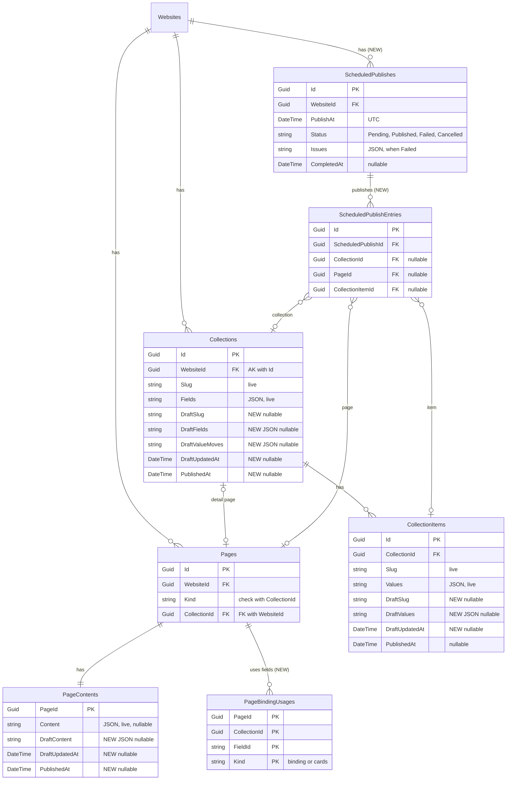

# Drafts and publishing

Status: **implemented** (branch `feature/drafts-and-publish`). Changes goal 2 of [page-content.md](page-content.md#1-goals): pages get drafts on the server.

## 0. What was built, and where it differs

Everything in § 4–7 is built: draft columns, `PublishCheckService` and `PublishService` (`Forma.Application/Publishing`), `ITransactionRunner`, `ScheduledPublishWorker` (`Publishing:WorkerInterval`, one minute by default), the endpoints of § 7, and in the app the shared editor controls, the publish dialog, "Publish together?" and scheduling. Where it differs:

- **New collections and items keep live columns from the start.** `Collections.Slug`/`Fields` and `CollectionItems.Slug`/`Values` stay non-nullable (unique indexes and every reader rely on them): a new one gets its first values both live and as the draft, and `PublishedAt IS NULL` keeps it off the site until it is published. `PageContents.Content` is nullable as designed.
- **`PageContents.DraftSchemaVersion`** is added next to `DraftContent`, because a draft is read with its own schema version.
- **Clearing a draft** is `ClearDraft = true` on `{Entity}Update`, since `null` means "leave as it is".
- **`PageContents.Status` and `CollectionItems.Status` are removed**; existing rows were converted by the migrations `AddDrafts` and `ClearUnpublishedContent` (SQLite rebuilds `PageContents` after the data SQL of the first, so clearing the live content of never-published pages runs in the second).
- **`needs`** is found by trying each other draft with the publish and keeping those that remove an error, for a few rounds, so a draft that needs another brings that one too ("Publish all 3").
- **Discarding** something that was never published is refused (`400`): there is no live version to go back to; delete it instead.
- **Extra endpoint** `GET /collections/{id}/usages` serves "Used by…" from `PageBindingUsages`, which is filled from live content at start-up when empty.
- **The studio shows collections as drafted**: a collection's draft fields can be bound, and items show their moved values, so pages can be fixed before the collection is published. The website preview shows only what is live.
- **Try again** on a failed scheduled publish publishes its drafts now (and cancels the failed one); **Publish now** on a pending one publishes them, which takes them out of it.
- **Item drafts** are checked for types and unknown fields when saved; required fields are checked when they are published.

## 1. The problem

Some edits only make sense together. Published one at a time, the site is broken in between:

- remove a collection field, add a new one, move the values across, and point the detail page and the cards on Home at the new field;
- redesign three pages and put them live at the same moment, now or on Monday at 9:00.

Today every save is live straight away (a collection's fields, an item) or nothing is stored until it is live (a page's design stays in the browser until Publish). There is no way to prepare changes and put them live together.

## 2. The idea

1. **Everything that can go live has a draft next to its live version.** Editing only ever changes the draft. Visitors only ever see the live version.
2. **Save** stores the draft. **Publish** puts drafts live: one, or several at once, chosen with checkboxes, in one database transaction.
3. **Before publishing, the server checks the result**: drafts being published, plus everything already live. Removing a field is fine when the pages that used it are fixed in the same publish.
4. **A publish can be scheduled**: the server runs it at the chosen date and time, with the same checks.

That is the whole system: draft columns, one publish service, and one table for scheduled publishes.

## 3. What has a draft

| Entity | Draft | Saves directly (can't break anything) |
|---|---|---|
| Page content | The page document | – |
| Collection | Slug and fields, plus how values move when a field is removed | Name, singular name, icon |
| Collection item | Slug and values | – |

A new page, collection or item starts as a draft only. It appears on the site when it is first published.

## 4. How it looks

### 4.1 In every editor

The studio, the collection's field editor and the item form share the same top-right corner:

```
 [ Draft · saved 2 min ago ]      [ Save ]   [ Publish  ▾ ]
                                                ├ Publish now
                                                ├ Schedule…
                                                ├ Publish with other changes…
                                                └ Discard changes
```

- **Status chip**, one of: *Live* (no draft) · *Unsaved changes* · *Draft · saved 2 min ago* · *Scheduled · Mon 24 Nov, 09:00* · *Not published: needs attention* (a scheduled publish failed).
- **Save** (also `Ctrl+S`) stores the draft. Nothing changes on the site. Toast: *"Saved as draft"*.
- **Publish** is the main button. It saves first, then publishes this one thing now. Toast: *"Blog post page is live"*.
- **Schedule…** opens a date and time picker for this one thing (§ 4.3).
- **Publish with other changes…** opens the publish dialog (§ 4.2) with this one ticked.
- **Discard changes** goes back to the live version, after an in-page confirmation (*"Discard your changes to Blog posts? The live version stays as it is."*). Not shown for something that was never published.

When **Publish** can't go alone because it depends on other drafts, it doesn't fail. It asks:

> **Publish together?**
> *Blog post page* shows *Hero image*, which isn't live yet. It's part of your draft of *Blog posts*.
> **[ Publish both ]**  [ Choose what to publish… ]  [ Cancel ]

### 4.2 The publish dialog

The app's top bar shows **"4 unpublished changes"** whenever a website has drafts. It opens the same dialog as *Publish with other changes…*.

```
 Publish changes                                                    ×
 ───────────────────────────────────────────────────────────────────
 Collections
  [x] Blog posts            Removed Cover image, added Hero image
                            14 items: Cover image moves to Hero image
 Pages
  [x] Blog post page        Edited 5 min ago        needed by Blog posts
  [x] Home                  Edited 1 h ago          needed by Blog posts
  [ ] About                 Edited yesterday
 Items
  [ ] Opening our studio    New
 ───────────────────────────────────────────────────────────────────
 ✓ Ready to publish 3 changes
                                   [ Schedule… ]   [ Publish now ]
```

- Every draft of the website is listed, grouped by kind, with a one-line summary of what changed.
- **Ticking something that needs other drafts ticks them too**, marked *needed by …*. Unticking one of those shows why it can't go alone, as a blocking line at the bottom, until it is ticked again or its dependent is unticked.
- The bottom line is the live result of the server's check (`POST /publish/check`): *Ready to publish 3 changes*, or the issues to fix, each with an **Open** link to the editor where it can be fixed.
- **Publish now** and **Schedule…** are disabled while anything blocks.
- Drafts that are already scheduled show *Scheduled · Mon 09:00* and are not ticked; they can't be in two publishes.

### 4.3 Scheduling

**Schedule…** (from an editor or the dialog) asks for a date and a time, shown in the browser's time zone with its name (*Europe/Amsterdam*). It must be in the future. Toast: *"Scheduled for Mon 24 Nov, 09:00"*.

- A **Scheduled** tab in the publish dialog lists upcoming publishes: when, what, and **Change time**, **Publish now** and **Cancel**.
- **A scheduled publish puts live the drafts as they are at that moment.** Editing a scheduled draft is allowed. The editor shows: *"Scheduled to go live on Mon 24 Nov at 09:00. Changes you save now go live then too."*
- The check runs when it is scheduled and again when it runs. If it fails when it runs, nothing is published. The publish is marked as failed, the top bar shows *"A scheduled publish didn't go live"*, and the Scheduled tab says why (*"Home shows a field that no longer exists"*), with **Open**, **Try again** and **Cancel**.
- **Discard changes** on a scheduled draft also removes it from its scheduled publish (*"It's also taken out of Monday's publish"*).

## 5. Database



- **A draft is a set of nullable `Draft…` columns.** `null` means "no draft". Publishing copies them to the live columns and clears them; discarding clears them. One draft per entity, so there is nothing to merge.
- **Live columns are nullable where something can exist before it is live** (`PageContents.Content`, and a new collection's or item's live fields are filled on first publish). A `Status` column is no longer needed: *live* is `PublishedAt IS NOT NULL`, *has changes* is `Draft… IS NOT NULL`.
- **`ScheduledPublishEntries` uses real foreign keys**, one nullable column per kind, with a check constraint that exactly one is set. Deleting a page, collection or item cascades out of its scheduled publish. Adding a kind later adds a column.
- **An entity is in at most one pending scheduled publish.** The publish service checks that when scheduling (SQLite can't index across the two tables).
- **`PageBindingUsages`** (planned in [collections.md § 4](collections.md#4-database)) is derived from live content on every publish. It answers *"Used by…"* in the field editor. The publish check doesn't need it: it reads the drafts it publishes directly.
- **Constraints the database can enforce**: `CK_Pages_Kind` (`Kind = 'Static' AND CollectionId IS NULL` or `Kind = 'CollectionTemplate' AND CollectionId IS NOT NULL`), and `Pages (WebsiteId, CollectionId)` → `Collections (WebsiteId, Id)`, so a detail page is on its collection's website.

## 6. Publishing

A **publish** is a list of what to put live: `{ websiteId, collections: [ids], pages: [ids], items: [ids] }`. The same shape is used by publish now, the check, and scheduled publishes.

**The check** (`PublishCheckService`) builds the site *as it would be*: for everything in the publish its draft, for everything else its live version. On that it runs the validation that already exists:

- item values against their collection's fields (`CollectionItemValidationService`);
- page documents, structural and publish checks (`PageContentValidationService`), including bindings and `collectionCards`;
- slugs still unique per website and per collection;
- every live page that uses a collection in the publish, even when that page isn't in it.

It answers with a summary per entity, the issues (`{ code, severity, message, entity }`, the shape the publish checks already use), and **`needs`**: drafts not in the publish that would fix a blocking issue. The dialog ticks those for you.

**Publish** (`PublishService`), inside one transaction (`ITransactionRunner`, which wraps `db.Database.BeginTransactionAsync`; the request-scoped `DbContext` makes every repository's `SaveChangesAsync` join it):

1. run the check; stop with `400` if anything blocks;
2. publish collections: copy draft slug and fields to live, then rewrite every item's live and draft values with `DraftValueMoves` (move or drop values of removed fields);
3. publish items and pages: copy drafts to live, set `PublishedAt`;
4. rebuild `PageBindingUsages` for the pages;
5. remove published entities from any pending scheduled publish;
6. commit. Any failure rolls back all of it.

These are supporting services; they call the core services with ordinary updates (`new PageContentUpdate { Content = …, DraftContent = null, PublishedAt = now }`). Core services and repositories stay CRUD only.

**Scheduled publishes** are run by `ScheduledPublishWorker`, a `BackgroundService` that wakes every minute, takes pending publishes whose `PublishAt` has passed, and runs `PublishService` on each. Success marks it `Published`; a blocking issue marks it `Failed` with the issues, and nothing is published. Times are stored in UTC. A publish missed while the API was down runs when it starts again.

## 7. API

| Method | Route | Purpose |
|---|---|---|
| `PUT` | `/pages/{id}/content/draft` | Save a page's draft `{ document }` (structural checks only), `200` or `400` |
| `GET` | `/pages/{id}/content?version=draft` | The draft, or the live version when there is none (default `live`) |
| `DELETE` | `/pages/{id}/content/draft` | Discard the draft |
| `PUT` / `DELETE` | `/collections/{id}/draft` | Save `{ slug, fields, valueMoves }` / discard |
| `PUT` | `/collections/{id}` | Name, singular name, icon: saved directly, as now, without `slug` and `fields` |
| `PUT` / `DELETE` | `/collections/{id}/items/{itemId}/draft` | Save `{ slug, values }` / discard |
| `GET` | `/drafts?websiteId=` | Every draft of a website, with a summary and its scheduled time, for the top bar and the dialog |
| `POST` | `/publish/check` | Check a publish: summaries, issues, `needs` |
| `POST` | `/publish` | Publish now: `200`, or `400` with the issues |
| `GET` / `POST` | `/scheduled-publishes?websiteId=` | Upcoming and failed publishes / schedule one `{ publishAt, collections, pages, items }`, `201` or `400` |
| `PUT` / `DELETE` | `/scheduled-publishes/{id}` | Change its time or what's in it / cancel it |

- `PUT /pages/{id}/content` (publish a page) goes: the studio saves the draft and calls `/publish` with that page.
- Every id in a publish is read with a filter narrowed by `websiteId`, so a publish can't reach another website (IDOR).

## 8. Later

- **Autosave** of drafts in the studio and the item form, now that drafts live on the server.
- **Named releases**: a scheduled publish with a name (*"Spring launch"*), shown as a group in the dialog.
- **History and undo**: keep the previous live version on every publish.
- **Conflicts between editors**: a `Version` column per entity once there is more than one user.
- **Page title and slug in the draft**, with links to the old slug updated in the same publish.

## 9. Implementation PR

One PR, in this order:

1. Migration: draft columns, `PublishedAt`, the `Pages` constraints, `PageBindingUsages`, `ScheduledPublishes` and `ScheduledPublishEntries`. Existing rows are live without a draft.
2. `ITransactionRunner`; draft endpoints for pages, collections and items; `GET /drafts`.
3. `PublishCheckService`, `PublishService`, `/publish/check` and `/publish`.
4. `ScheduledPublishWorker` and the scheduled-publish endpoints.
5. App: status chip, Save, Publish menu and "Publish together?" in every editor; the top-bar count and publish dialog; scheduling. `npm run generate:api`.
6. Tests: a publish rolls back when one step fails; a field removal blocks until the pages using it are in the publish; `needs` names those pages; a scheduled publish runs, and fails without publishing when blocked; discarding a scheduled draft removes it from the publish.
7. Update [page-content.md](page-content.md), [page-content-api.md](page-content-api.md) and the data model diagram in `src/api/README.md`.
