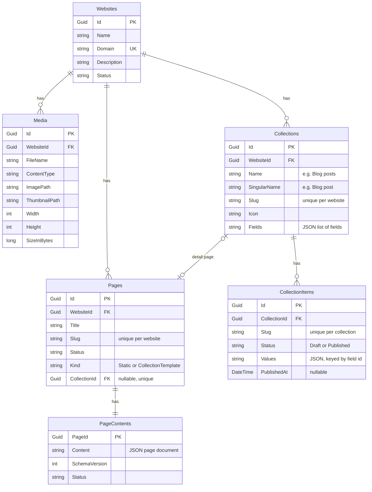
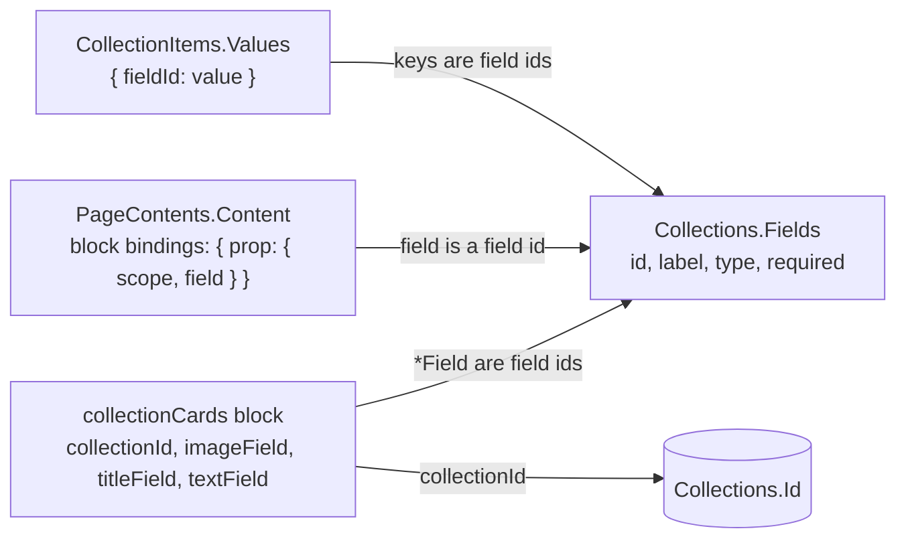

# Forma — API

The Forma backend: .NET 10 minimal APIs, EF Core and SQLite.

```bash
dotnet run --project src/api/Forma.Api --launch-profile http   # http://localhost:5134, docs at /scalar
dotnet test src/api/Forma.Api.slnx
```

In development the API applies migrations and seeds sample data on startup into `forma.db` (git-ignored). Each `dotnet build` writes the OpenAPI document to `Forma.Api/OpenApi/forma-api.json`; the app's client is generated from it (`npm run generate:api -w forma-app`).

## Projects

| Project                | Responsibility                                                       |
| ---------------------- | -------------------------------------------------------------------- |
| `Forma.Api`            | Minimal API endpoints, DTOs and Mapperly mappers, OpenAPI + Scalar   |
| `Forma.Application`    | Domain entities, core and supporting services, the page document model and its validation |
| `Forma.Infrastructure` | EF Core `DbContext`, SQLite, migrations, seeding, repositories, media file storage and image processing |
| `Forma.Analyzers`      | Build rules for the repositories (FORMA001–003)                       |
| `Forma.Tests`          | xUnit: studio contract tests, validation and API tests               |

A request goes endpoint → (supporting service) → core service → repository → DAO. How each layer is written is in [`CLAUDE.md`](../../CLAUDE.md).

## Data model

The SQLite tables, from the EF Core model snapshot. Every table also has `CreatedAt` and `UpdatedAt`, and every foreign key cascades on delete.



A collection's detail page is a `Pages` row with `Kind = CollectionTemplate` and slug `{collection}/{item}`. Some references live inside JSON columns, so the API checks them and the database doesn't:


